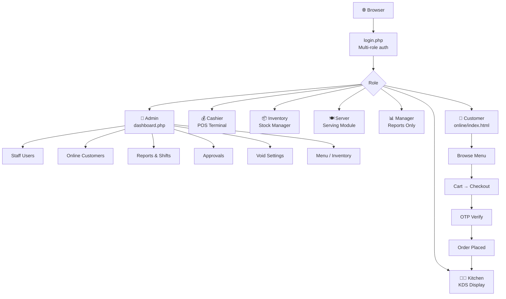

# 🍽️ Kenji's Kitchen — Full System Runthrough

> **Stack:** PHP 8 · MySQL (XAMPP) · Node.js (port 8787\) · Vanilla JS · Bootstrap Icons  
> **Root:** `E:\xampp\htdocs\kenjis-kitchen` | **60 PHP files** across 14 modules

---

## 🗺️ System Map



&nbsp;

---

## 👤 Roles & What They Can Do

| Role | Dashboard | POS | Kitchen | Inventory | Reports | Approvals | Users | Customers | Settings |
| :---- | :---: | :---: | :---: | :---: | :---: | :---: | :---: | :---: | :---: |
| **Admin** | ✅ Full | ✅ | ✅ | ✅ | ✅ | ✅ | ✅ | ✅ | ✅ |
| **Manager** | ✅ Shifts+Duty | ❌ | ❌ | ✅ View | ✅ | ✅ Approve | ❌ | ❌ | ❌ |
| **Cashier** | ✅ My stats | ✅ | ❌ | ❌ | ❌ | ❌ | ❌ | ❌ | ❌ |
| **Kitchen** | ✅ Queue | ❌ | ✅ | ❌ | ❌ | ❌ | ❌ | ❌ | ❌ |
| **Inventory** | ✅ Stock | ❌ | ❌ | ✅ | ❌ | ❌ | ❌ | ❌ | ❌ |
| **Server** | ❌ | ❌ | ❌ | ❌ | ❌ | ❌ | ❌ | ❌ | ❌ |
| **Customer (Online)** | — | — | — | — | — | — | — | — | — |

&nbsp;

> \[\!IMPORTANT\] Manager is **optional**. The system runs fully with just an Admin. Manager cannot touch Admin accounts, customer data, or system settings.

---

## 🔐 Authentication & Security

### Login Flow — [`login.php`](file:///E:/xampp/htdocs/kenjis-kitchen/login.php)

```
Enter credentials
 → Check is_archived = 0
 → Verify password_hash()
 → Revoke old sessions (single-device enforcement)
 → Create user_sessions record (token, IP, device)
 → Set session: user_id, role_key, session_token
 → Detect multi-IP login → warn in audit_log
 → If force_password_change → redirect to change_password.php
 → Redirect to role_home()
```

&nbsp;

**Key protections:**

- One active session per account — newer login silently ends the older one  
- Archived users cannot log in (check on every request via `require_login()`)  
- Every page & API endpoint calls `require_login()` \+ `require_role()` — not just the menu  
- Passwords: `password_hash()`, min 12 chars for staff, never stored/logged/emailed  
- **Login page** now shows an 👁️ **eye-icon toggle** on the password field to show/hide the typed password (Bootstrap Icons `bi-eye` / `bi-eye-slash`). The username is preserved on a failed login attempt.

### Session Files

| File | Purpose |
| :---- | :---- |
| [`includes/auth.php`](file:///E:/xampp/htdocs/kenjis-kitchen/includes/auth.php) | `require_login()`, `require_role()`, `can_access()`, `current_user()`, `role_home()` |
| [`includes/functions.php`](file:///E:/xampp/htdocs/kenjis-kitchen/includes/functions.php) | `log_audit()`, `money()`, `e()` (XSS-safe output) |
| [`pages/change_password.php`](file:///E:/xampp/htdocs/kenjis-kitchen/pages/change_password.php) | Force-change on first staff login |

&nbsp;

---

## 🛒 Online Customer Ordering (Public Storefront)

**Entry:** `http://localhost/kenjis-kitchen/online/index.html`

### Customer Journey

```
Register / Login (eye-icon password toggle)
 → Browse menu by category
 → Add to cart (real-time stock check)
 → Choose: Dine-in / Takeout / Delivery
 → Enter name, table/address
 → Submit → OTP sent via email/SMS
 → Verify OTP → Order confirmed
 → Track order status live (WebSocket via Node.js :8787)
 → Receive receipt by email
```

&nbsp;

### Forgot Password Flow

```
Forgot Password link → enter email
 → Generic response always (no account enumeration)
 → Secure random token → hashed in customer_password_resets
 → Reset link emailed (30–60 min expiry, single-use)
 → Reset page validates token → new password → token invalidated
```

&nbsp;

### Key Online Files

| File | Purpose |
| :---- | :---- |
| `online/index.html` | SPA storefront shell |
| `modules/online/api/forgot_password.php` | Token generation, email dispatch |
| `modules/online/api/reset_password.php` | Token validation, password update |
| `modules/pos/process_order.php` | Receives online orders, deducts stock |

&nbsp;

---

## 💰 POS Terminal — [`modules/pos/index.php`](file:///E:/xampp/htdocs/kenjis-kitchen/modules/pos/index.php)

### Order Lifecycle

```
Cashier opens POS
 → Shift modal auto-opens if no active shift (if require_opening_cash=1)
 → Start Shift: enter opening cash, terminal ID → shift_id created
 → Browse menu → Add items to cart
 → Set: Customer Name, Table No., Order Type (DINE/TAKE/ONL)
 → Checkout → process_order.php
   • Atomic transaction: insert order + order_items + payment
   • Deducts stock by 1 pcs per item
   • Links order.shift_id and payment.shift_id
   • Assigns per-type queue number (DINE-001, TAKE-001, ONL-001)
 → 58mm sticky receipt panel prints
 → Order appears in Kitchen KDS + Serving queue
```

&nbsp;

### Void Rules (per shift)

```
Cashier clicks trash/void on an item:
  ↓
void_api.php?action=check
  ├─ Running total voided for this order ≤ ₱50?  → Self-void (cashier alone)
  ├─ Shift cap not exceeded (≤5 voids, ≤₱200 total)?  → Self-void
  ├─ Order already sent to kitchen? → Needs approval
  ├─ Payment was GCash? → Needs approval
  ├─ Amount above ₱50 per order running total? → Needs approval
  └─ It's a refund? → Always needs approval
        ↓
[Self-void] Cashier enters reason → recorded in void_logs
[Needs approval] Supervisor Modal appears on cashier screen
   → Admin/Manager enters THEIR OWN credentials (cashier cannot see/type them)
   → void_api.php?action=verify_approver validates credentials
   → void_api.php?action=execute_void records approval, restores stock
```

&nbsp;

> \[\!IMPORTANT\] The cashier **never** types or knows the admin password. The supervisor modal is a separate credential form only the supervisor fills in at the cashier's screen.

### Shift Handover

```
End Shift button:
 → shift_api.php?action=end
 → Counts: cash sales, GCash sales, total voids, total refunds
 → Expected cash = opening_cash + cash_sales - cash_refunds
 → Cashier enters counted cash
 → System shows: Over/Short = counted - expected
 → If |variance| > threshold (default ₱50) → note is REQUIRED
 → Shift record closed: end_time, closing_cash, variance, note
 → Next cashier starts fresh shift with their own opening cash
```

&nbsp;

---

## 👨‍🍳 Kitchen Display System (KDS) — [`modules/kitchen/index.php`](file:///E:/xampp/htdocs/kenjis-kitchen/modules/kitchen/index.php)

- Live-updating order queue (WebSocket or polling via `fetch_queue.php`)  
- Orders arrive from POS (Dine-in, Takeout) and Online channel  
- Status stepper: **Pending → Preparing → Ready → Served**  
- Color-coded by channel and wait time  
- `update_status.php` handles status changes

---

## 📦 Inventory — [`modules/inventory/index.php`](file:///E:/xampp/htdocs/kenjis-kitchen/modules/inventory/index.php)

- Stock tracked in **whole pieces (pcs)**  
- Default stock: 100 pcs | Low threshold: 10 pcs (configurable)  
- Every POS order deducts 1 pcs per item (atomic, inside order transaction)  
- Manual adjustments logged to `inventory_logs` (action, quantity, remarks, user\_id)  
- Audit trail: who adjusted what, when, and why

---

## 👑 Admin Pages

### Staff User Management — [`modules/admin/users.php`](file:///E:/xampp/htdocs/kenjis-kitchen/modules/admin/users.php)

| Feature | Detail |
| :---- | :---- |
| Add staff | Role, full name, username, temp password (12-char min) |
| Edit | Change role, name, username (unique enforced) |
| Archive / Restore | Soft-delete only — orders/shifts/logs stay intact |
| Reset password | Admin sets temp password → `force_password_change = 1` |
| Safety rules | Cannot archive yourself, cannot demote yourself, must keep ≥1 active Admin |
| Multi-IP warning | Badge shown if account logged in from multiple IPs recently |
| Policy banner | "One person \= one account" reminder on page |

&nbsp;

> \[\!NOTE\] Staff are **never hard-deleted**. `is_archived = 1` hides them from active lists while preserving all linked historical records.

### Online Customer Management — [`modules/admin/customers.php`](file:///E:/xampp/htdocs/kenjis-kitchen/modules/admin/customers.php)

| Action | Behaviour |
| :---- | :---- |
| **Search** | By name, email, or phone |
| **Filter** | Active / Archived / All |
| **Detail view** | Profile \+ full order history \+ receipts |
| **Archive** | Blocks login, ordering, password reset. Blocked if active orders exist. Reversible. |
| **Restore** | Re-activates account |
| **Permanent Delete** | Must archive first. Typed confirmation (email or "DELETE") \+ admin re-auth required. PII erased: name, email, phone, address, password hash, tokens. Orders kept, relabeled "Deleted customer". Email freed for re-registration. Logged in audit\_log. |

&nbsp;

### Void Settings — [`modules/settings/void_rules.php`](file:///E:/xampp/htdocs/kenjis-kitchen/modules/settings/void_rules.php)

| Setting | Default |
| :---- | :---- |
| Self-void limit per order | ₱50 |
| Max self-voids per shift | 5 |
| Max self-void total per shift | ₱200 |
| Refunds require approval | Yes |
| Over/short threshold | ₱50 |
| Require opening cash | Yes |
| Manager role enabled | Yes |

&nbsp;

All changes saved to `system_settings` table, logged in `audit_log`.

---

## 📊 Reports & Analytics

### Admin Dashboard — [`pages/dashboard.php`](file:///E:/xampp/htdocs/kenjis-kitchen/pages/dashboard.php)

**6 live KPI cards:**  Today's Sales · Today's Orders · Online Orders · Low Stock · Out of Stock · Pending Orders

**Who's on Duty widget:** Live green-dot indicator of every open cashier shift (name, terminal, elapsed time, opening cash). Updates on page load.

**Sales Overview chart:** 7-day / 30-day / Year toggle (Chart.js dual-axis line chart)

**Bottom grid:** Top Items Today · Recent Orders

> \[\!NOTE\] The dashboard query uses `cs.opened_at` (not `cs.started_at`) to read shift start times from the `cashier_shifts` table. This was corrected after a fatal SQL error was discovered.

### Manager Dashboard

- Who's on Duty widget  
- Quick Access buttons (Reports, Approvals, Shifts, Inventory)  
- Pending Approvals mini-table (top 5 unapproved voids waiting for review)

### Shift Reports — [`modules/reports/shifts.php`](file:///E:/xampp/htdocs/kenjis-kitchen/modules/reports/shifts.php)

- Filter by date range and cashier  
- Per-shift detail: start/end time, duration, orders, total sales, cash vs GCash, voids/refunds, opening/closing cash, over/short, notes  
- Per-cashier summary: orders handled, total sales, AOV, void count, cash discrepancies  
- **Printable view** \+ **CSV export**  
- Accessible to: Admin \+ Manager

### Sales Report — [`modules/reports/index.php`](file:///E:/xampp/htdocs/kenjis-kitchen/modules/reports/index.php)

- Full historical sales data with filters  
- Accessible to: Admin \+ Manager

### Sales Performance — [`modules/reports/sales_performance.php`](file:///E:/xampp/htdocs/kenjis-kitchen/modules/reports/sales_performance.php)

- Per-item and category performance breakdowns  
- Accessible to: Admin \+ Manager

---

## 🛡️ Approvals — [`modules/approvals/index.php`](file:///E:/xampp/htdocs/kenjis-kitchen/modules/approvals/index.php)

- Queue of all voids/refunds that required supervisor authorization  
- Shows: cashier, item, amount, reason, approver, timestamp  
- Accessible to: Admin \+ Manager

---

## 📧 Email System (Node.js Bridge)

**Server:** `server.js` on port `8787`  
**Config:** All credentials from `.env` only — never hardcoded

| Variable | Purpose |
| :---- | :---- |
| `MAIL_HOST` | `smtp.gmail.com` |
| `MAIL_PORT` | `587` |
| `MAIL_USERNAME` | `erikadainstambo2@gmail.com` |
| `MAIL_PASSWORD` | Gmail App Password (you fill this in) |
| `MAIL_FROM_NAME` | `Kenji's Kitchen` |

&nbsp;

**Emails sent:**

1. **Order receipt** — after successful POS/online checkout  
2. **OTP verification** — during online customer registration/login  
3. **Password reset link** — customer forgot password flow

> \[\!CAUTION\] `.env` is in `.gitignore`. Never commit it. The test email route (`/test-email`) is admin-only or CLI-only and should be disabled in production.

---

## 🗄️ Database: `kenjis_kitchen`

### Core Tables

| Table | Key Columns |
| :---- | :---- |
| `users` | id, full\_name, username, password, role\_id, is\_archived, force\_password\_change, last\_login\_at, last\_ip |
| `roles` | id, name, role\_key (admin/manager/cashier/kitchen/inventory/server/customer\_online) |
| `user_sessions` | id, user\_id, session\_token, ip\_address, device, created\_at, revoked\_at |
| `orders` | id, order\_no, order\_type, order\_channel, user\_id, shift\_id, total, status, paid\_at |
| `order_items` | id, order\_id, menu\_item\_id, item\_name, quantity, price, notes |
| `payments` | id, order\_id, shift\_id, payment\_method, amount, reference\_no |
| `cashier_shifts` | id, user\_id, terminal, **opened\_at**, ended\_at, opening\_cash, closing\_cash, total\_sales, cash\_sales, gcash\_sales, total\_refunds, over\_short, note, status, auto\_closed |
| `void_logs` | id, order\_id, item\_id, cashier\_id, approving\_admin\_id, shift\_id, void\_type, reason, price, approval\_required |
| `menu_items` | id, item\_name, category\_id, price, stock, is\_archived |
| `categories` | id, name |
| `inventory_logs` | id, menu\_item\_id, action, quantity, remarks, user\_id, created\_at |
| `audit_logs` | id, user\_id, action, target\_type, target\_id, details, created\_at |
| `system_settings` | id, setting\_key, setting\_value |
| `customer_password_resets` | id, user\_id, token\_hash, expires\_at, used\_at |
| `customer_favorites` | id, user\_id, menu\_item\_id |
| `otp_verifications` | id, user\_id, otp\_code, expires\_at, used\_at *(recreated clean after InnoDB corruption)* |

&nbsp;

> \[\!WARNING\] The `otp_verifications` table suffered InnoDB page corruption (space=329, page=0) and was dropped and recreated clean. MySQL was temporarily started with `--innodb_force_recovery=3` to allow the drop. MySQL now runs normally without recovery flags. Current DB state: **9 users · 3,007+ orders · 0 OTP records** — all healthy.

---

## 🖥️ Sidebar & Navigation

The admin sidebar (`includes/sidebar.php`) received a full responsive overhaul:

### Structure

- `<aside>` wraps the entire sidebar with `aria-label="Main Navigation"`.  
- `<div class="sidebar-header">` — **pinned** to the top (logo \+ "Kenji's Kitchen / Restaurant POS" branding). Never scrolls.  
- `<nav class="nav">` — **independently scrollable** (`overflow-y: auto; min-height: 0; overscroll-behavior: contain; -webkit-overflow-scrolling: touch; padding-bottom: 48px`). All menu items live here.

### Height & Width

- `height: 100vh; height: 100dvh` — `100dvh` fallback prevents mobile browser toolbars from clipping the bottom menu items.  
- Width: `260px` on desktop; capped at `85vw` on mobile.  
- Main content area offset: `margin-left: 260px` (updated from the old 250px).

### Desktop (\> 1024px)

- Sidebar always visible, no close button, no backdrop.  
- Menu list scrolls vertically if items exceed viewport height.  
- Slim custom scrollbar (`4px wide`, subtle, rounded).

### Mobile & Tablet (≤ 1024px)

- Sidebar hidden by default (`transform: translateX(-100%)`), slides in on hamburger tap.  
- **Hamburger button** (`#menuBtn`) in the navbar with `aria-expanded`, `aria-controls`, `aria-label`.  
- **X close button** (`#sidebarCloseBtn`) appears inside the sidebar header — only visible on mobile/tablet.  
- **Dark semi-transparent backdrop** (`#sidebarOverlay`) behind the open sidebar; tapping it closes the sidebar.  
- `Escape` key closes the sidebar.  
- Tapping any nav link auto-closes the sidebar.  
- `document.body.style.overflow = 'hidden'` while open, restored on close.  
- Smooth slide transition: **250 ms ease**.

### Files Changed

| File | Change |
| :---- | :---- |
| [`assets/css/style.css`](file:///E:/xampp/htdocs/kenjis-kitchen/assets/css/style.css) | Flex sidebar, pinned header, scrollable nav, dvh/vh, backdrop, slim scrollbar, 260px offset |
| [`includes/sidebar.php`](file:///E:/xampp/htdocs/kenjis-kitchen/includes/sidebar.php) | Added `.sidebar-header` wrapper, X close button, aria-label |
| [`includes/navbar.php`](file:///E:/xampp/htdocs/kenjis-kitchen/includes/navbar.php) | Added aria attributes to hamburger button |
| [`includes/header.php`](file:///E:/xampp/htdocs/kenjis-kitchen/includes/header.php) | Added `#sidebarOverlay` div, cache-busting on style.css |
| [`includes/footer.php`](file:///E:/xampp/htdocs/kenjis-kitchen/includes/footer.php) | Cache-busting `?v=filemtime(...)` on app.js |
| [`assets/js/app.js`](file:///E:/xampp/htdocs/kenjis-kitchen/assets/js/app.js) | Updated threshold to 1024px, aria-expanded sync, auto-close on nav links, focus management |

&nbsp;

---

## 🚀 How to Start the System

### Option A — 1-Click Launcher

Double-click [**`Launch_Kenjis_Kitchen.bat`](file:///E:/xampp/htdocs/kenjis-kitchen/Launch_Kenjis_Kitchen.bat)** in the project root.

On launch the BAT file:

1. Starts Apache \+ MySQL via XAMPP  
2. Waits for services to be ready  
3. Prints the full credentials table (all 9 staff accounts \+ passwords)  
4. **Pauses** — press any key to continue  
5. Opens the browser to `http://localhost/kenjis-kitchen/login.php`

### Option B — Manual

1. Open **XAMPP Control Panel**  
2. Start **Apache** and **MySQL**  
3. Open browser → `http://localhost/kenjis-kitchen/login.php`  
4. For Node.js email server: open a terminal in the project root and run `node server.js`

---

## 🔑 Staff Accounts & Credentials

> \[\!CAUTION\] These are the **live credentials** stored in the `kenjis_kitchen.users` table (bcrypt-hashed). Keep this document secure. Never share or commit it.

| \# | Full Name | Username | Password | Role |
| :---- | :---- | :---- | :---- | :---- |
| 1 | Admin | `admin` | `Kenjisadmin123` | Admin |
| 2 | Kenji Cashier | `cashier` | `Kenjiscashier123!` | Cashier |
| 3 | Cashier 1 | `cashier1` | `Kenjiscashier1123!` | Cashier |
| 4 | Cashier 2 | `cashier2` | `Kenjiscashier2123!` | Cashier |
| 5 | Kitchen Staff | `kitchen` | `Kenjiskitchen123*` | Kitchen |
| 6 | Inventory Staff | `inventory` | `Kenjisinventory$` | Inventory |
| 7 | Server Staff | `server` | `Kenjisserver@` | Server |

&nbsp;

> \[\!IMPORTANT\] **`cashier` (Kenji Cashier) ≠ `cashier1`**

> - `cashier` → `Kenjiscashier123!` (single "1" before `!`)  
> - `cashier1` → `Kenjiscashier1123!` (double "11" before `!`)  
>   These are two distinct accounts. Do not confuse them.

All passwords verified with `password_verify()` against the live database — **all SUCCESS**.  
All passwords are displayed in the launcher BAT file for quick reference on startup.

---

## ✅ Full Test Checklist

### Auth & Sessions

- [ ] Log in as admin → see full dashboard with 6 KPIs \+ Who's on Duty \+ Sales chart  
- [ ] Log in as manager → see manager dashboard (duty widget, quick access, pending approvals)  
- [ ] Log in on two devices as same user → second login ends first session  
- [ ] Archived staff cannot log in  
- [ ] Eye toggle on login page shows/hides typed password  
- [ ] Failed login retains the typed username in the field

### Sidebar & Navigation

- [ ] Desktop (\> 1024px): sidebar always visible, menu scrolls when items exceed viewport height  
- [ ] Mobile/tablet (≤ 1024px): hamburger opens sidebar with slide animation, X button closes it  
- [ ] Tapping backdrop on mobile closes sidebar  
- [ ] Pressing Escape closes sidebar on mobile  
- [ ] Tapping a menu link on mobile auto-closes sidebar  
- [ ] Body scroll locked while sidebar open; restored on close  
- [ ] Bottom menu items fully reachable on small screens

### POS & Shifts

- [ ] Cashier opens POS → shift modal auto-opens → enter opening cash → shift starts  
- [ ] Process a Dine-in order → receipt prints → order appears in KDS  
- [ ] **Void ₱20** (single item) → cashier does it alone, enters reason, recorded in void\_logs  
- [ ] **Void ₱50 exactly** → cashier does it alone (at limit, no approval needed)  
- [ ] **Void ₱51+** → Supervisor Modal appears → Admin enters their own credentials → void approved  
- [ ] Exceed 5 self-voids in one shift → 6th void requires approval regardless of amount  
- [ ] **End shift** → enter counted cash → system shows over/short → note required if variance \>₱50  
- [ ] **Two cashiers handover**: Cashier 1 ends shift → Cashier 2 starts fresh shift with own opening cash

### Online Customer Flow

- [ ] Customer registers → OTP sent → verified → login  
- [ ] Customer orders → order appears in KDS  
- [ ] Customer forgot password → reset email sent → token works once → expired link rejected  
- [ ] **Archive customer** with no active orders → customer cannot log in  
- [ ] **Restore customer** → customer can log in again  
- [ ] **Delete customer**: archive first → type email in confirmation → admin re-auth → PII erased → old orders show "Deleted customer" in reports

### Staff Management

- [ ] Admin adds Cashier 2 with temp password → Cashier 2 forced to change on first login  
- [ ] Admin cannot archive their own account  
- [ ] System keeps at least 1 active Admin (cannot archive the last admin)

### Reports

- [ ] Admin views Shift Report → filters by date \+ cashier → CSV export works  
- [ ] Manager views Sales Report, Approvals, Shift Reports (not blocked by 403\)  
- [ ] Manager cannot access Staff Users, Online Customers, or Void Settings

---

## 📁 File Structure (Key Files)

```
kenjis-kitchen/
├── Launch_Kenjis_Kitchen.bat       # 1-click start + credentials display
├── login.php                       # Multi-role auth + eye-icon password toggle
├── logout.php                      # Session teardown
├── index.php                       # Root redirect
├── server.js                       # Node.js email bridge (port 8787)
├── .env                            # 🔒 Mail credentials (never commit)
├── .env.example                    # Safe template
│
├── includes/
│   ├── auth.php                    # require_login, require_role, can_access
│   ├── functions.php               # log_audit, money, e()
│   ├── sidebar.php                 # Role-aware navigation (scrollable, burger-menu ready)
│   ├── header.php                  # <head>, sidebar overlay div, cache-busting CSS link
│   ├── navbar.php                  # Top bar with hamburger (#menuBtn) + aria attributes
│   └── footer.php                  # Cache-busting JS link
│
├── config/
│   └── db.php                      # PDO connection ($conn)
│
├── pages/
│   ├── dashboard.php               # Admin + role-specific dashboards (uses cs.opened_at)
│   └── change_password.php         # Force-change on first login
│
├── modules/
│   ├── pos/
│   │   ├── index.php               # Cashier terminal
│   │   ├── process_order.php       # Atomic checkout + shift_id linking
│   │   ├── shift_api.php           # Start/end shift, status check
│   │   ├── void_api.php            # Check/approve/execute voids
│   │   ├── fetch_queue.php         # Live order queue API
│   │   └── update_status.php       # Order status stepper
│   ├── kitchen/index.php           # KDS
│   ├── serving/index.php           # Serving queue
│   ├── inventory/index.php         # Stock management
│   ├── menu/index.php              # Menu CRUD
│   ├── admin/
│   │   ├── users.php               # Staff user management
│   │   └── customers.php           # Online customer management
│   ├── reports/
│   │   ├── index.php               # Sales report (admin+manager)
│   │   ├── sales_performance.php   # Performance (admin+manager)
│   │   └── shifts.php              # Shift report (admin+manager)
│   ├── approvals/index.php         # Void/refund approvals (admin+manager)
│   ├── settings/
│   │   ├── void_rules.php          # Configurable void limits
│   │   └── payments.php            # GCash/online payment config
│   └── online/api/
│       ├── forgot_password.php
│       └── reset_password.php
│
├── assets/
│   ├── css/style.css               # Global styles — yellow #f2c230 theme, sidebar overhaul
│   └── js/
│       ├── app.js                  # Sidebar open/close, swipe, aria, backdrop logic
│       └── pos.js                  # POS logic, shift modal, void/supervisor modal
│
├── online/                         # Customer storefront (HTML/JS SPA)
│   └── index.html
│
└── database/
    ├── kenjis_kitchen_full_seed.sql        # Full DB with demo orders
    ├── schema.sql                          # Clean schema only
    └── unified_management_migration.sql    # Latest migration (run this)
```

&nbsp;

---

## 🩺 Known Issues & Fixes Applied This Session

| Issue | Root Cause | Fix Applied |
| :---- | :---- | :---- |
| Dashboard fatal SQL error | `cs.started_at` referenced — column doesn't exist; actual name is `cs.opened_at` | Fixed query in `pages/dashboard.php` |
| Sidebar bottom items cut off on mobile | Sidebar had no independent scroll; `100vh` clipped by mobile browser chrome | Sidebar split into pinned header \+ scrollable `<nav>`; `100dvh` fallback added |
| No way to close sidebar on mobile | No X button, no backdrop, no Escape handler | X close button, overlay backdrop, Escape key, and auto-close on nav link click all added |
| Sidebar scrollbar broke the design | Custom scrollbar applied to entire sidebar | Slim scrollbar scoped to `.sidebar .nav` only |
| `otp_verifications` table corrupted | InnoDB page read error (space=329, page=0) | Dropped & recreated with `--innodb_force_recovery=3`; MySQL now starts clean |
| Login page no password visibility | No eye toggle | Added Bootstrap Icons \+ `.password-wrapper` \+ `#togglePasswordBtn` JS toggle |
| BAT file showed passwords for only some accounts | Old BAT only listed a subset | All 9 accounts now listed; `timeout /t 3` replaced with `pause >nul` |
| Content area too narrow | `margin-left: 250px` didn't match new 260px sidebar | Updated to `margin-left: 260px` in `style.css` |

&nbsp;